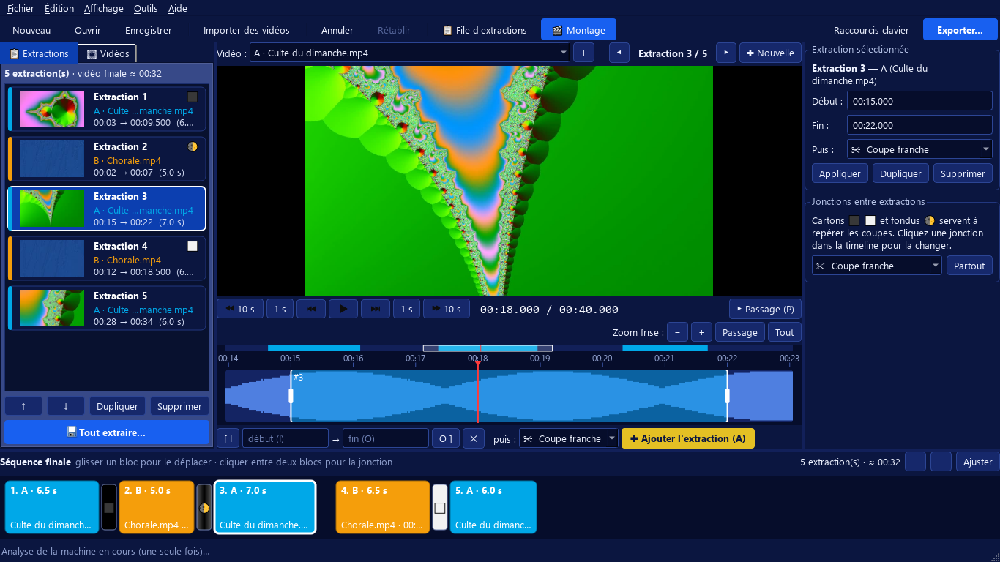
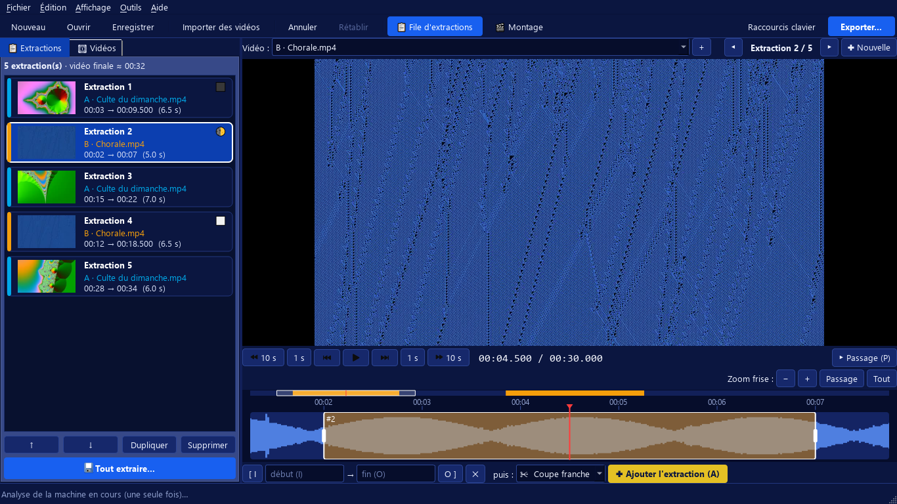
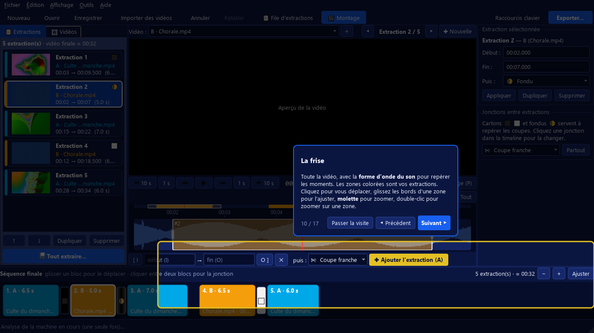

  

<h1 align="center">Cut Together</h1>

  <b>Extraire les meilleurs passages de plusieurs vidéos et les assembler en une seule.</b> 
  Sur Windows, 100 % en local, gratuit, sans droits administrateur.

  <a href="https://github.com/MikeDns/MonteurVideo/releases/latest"><b>⬇ Télécharger la dernière version</b></a>

---

## À quoi ça sert

Vous avez filmé un culte, une conférence ou un événement en plusieurs vidéos et vous voulez **une seule vidéo avec les moments importants**, dans l'ordre que vous choisissez.

1. **Importez** vos vidéos et vos GIF.
2. **Marquez** les passages à garder : touche **I** pour le début, **O** pour la fin, **A** pour ajouter. On peut en prendre plusieurs dans une même vidéo.
3. **Réordonnez** librement, en mélangeant les vidéos, avec un carton noir ou blanc, ou un fondu, entre deux passages.
4. **Exportez** une seule vidéo, ou un fichier par passage.

## Fonctionnalités

| | |
|---|---|
| 🎞 **Plusieurs vidéos, plusieurs passages** | Autant de passages que nécessaire dans chaque vidéo, dans l'ordre de votre choix |
| 🔊 **Forme d'onde du son** | Pour repérer d'un coup d'œil les prises de parole, les chants, les silences |
| 🎯 **Coupes précises à l'image** | Image par image au clavier, temps modifiables à la milliseconde |
| ⬛ ⬜ 🌓 **Jonctions** | Coupe franche, carton noir ou blanc, ou fondu entre deux passages |
| ⚡ **Export rapide** | Utilise la carte graphique quand elle le permet (Intel Quick Sync, NVIDIA, AMD), sinon le processeur |
| 🧠 **S'adapte à chaque PC** | Mesure ce que la machine sait faire et règle l'export et l'aperçu en conséquence |
| 📱 **Vidéos de téléphone (4K, HEVC 10 bits)** | Si votre PC a du mal à les lire, une copie légère est créée automatiquement pour un aperçu fluide. L'export utilise toujours la vidéo d'origine, en pleine qualité |
| 🧭 **Visite guidée intégrée** | Chaque zone et chaque bouton expliqués dans l'appli, au premier lancement |
| 🎨 **Couleurs au choix** | Thème « Count Together » (bleu roi et or) par défaut, autres thèmes ou vos propres couleurs |
| 🔄 **Mises à jour intégrées** | Proposées dans l'appli, vérifiées avant installation, avec retour possible à la version précédente |

<table>
  <tr>
    <td width="50%"> <b>Vue « File d'extractions »</b> : on règle les passages un par un.</td>
    <td width="50%"> <b>Visite guidée</b> : chaque zone est expliquée dans l'appli.</td>
  </tr>
</table>

## Installation

**Configuration requise :** Windows 10 ou 11 (64 bits), 4 Go de mémoire (8 Go conseillés), environ 1 Go d'espace disque, et une connexion internet **au premier lancement**.

1. Téléchargez **`MonteurVideo-Setup-x.y.z.exe`** dans la [dernière version](https://github.com/MikeDns/MonteurVideo/releases/latest), rubrique *Assets*.
2. Lancez-le. **Aucun droit administrateur** n'est nécessaire.
3. Au premier lancement, Cut Together prépare **une seule fois** Python et ses composants vidéo (FFmpeg, lecteur). Cela prend quelques minutes, puis la visite guidée démarre.

> **« Windows a protégé votre ordinateur » ?** Ce message de Windows SmartScreen s'affiche pour les logiciels récents qui ne sont pas encore signés numériquement. Cliquez sur **Informations complémentaires**, puis sur **Exécuter quand même**. Le fichier est vérifié : son empreinte SHA-256 est publiée avec chaque version (`SHA256SUMS.txt`).

## Mises à jour

Cut Together vérifie lui-même s'il existe une nouvelle version (au plus une fois par jour) et la propose dans la barre du bas. L'installation se fait en un clic. **Vos projets et réglages sont conservés.**

En cas de souci : **Aide › Revenir à la version précédente**.

## Vos données

- **Tout reste sur votre PC** : aucune vidéo n'est envoyée sur internet, aucun compte n'est nécessaire.
- Seules connexions : le premier lancement (composants) et la vérification des mises à jour, sur GitHub.
- Réglages : `%APPDATA%\MonteurVideo`. Cache (formes d'onde, vignettes, copies d'aperçu) : `%LOCALAPPDATA%\MonteurVideo`. Le cache des copies d'aperçu se vide dans **Outils › Proxys d'aperçu**.

## Désinstallation

**Paramètres Windows › Applications**, choisir **Cut Together**, puis **Désinstaller**. Vos vidéos, vos projets et vos réglages ne sont pas supprimés.

## Questions fréquentes

<b>Le premier lancement échoue (« connexion internet ? »)</b>

Le premier lancement télécharge Python et les composants vidéo. Vérifiez la connexion, puis relancez Cut Together : il reprend là où il s'était arrêté. Derrière un proxy d'entreprise, les certificats de Windows sont utilisés automatiquement.

<b>La lecture d'une vidéo de téléphone saccade</b>

Pour une vidéo 4K ou HEVC 10 bits, Cut Together crée une copie légère, si votre PC en a besoin. L'avancement s'affiche sous l'aperçu. En attendant, l'original reste utilisable. Réglage : **Outils › Proxys d'aperçu**.

<b>L'export est-il de bonne qualité ?</b>

Oui. L'export part toujours des vidéos d'origine et coupe à l'image près. Le mode **rapide** (sans réencodage) n'est proposé que quand toutes les vidéos ont exactement le même format.

<b>Comment revoir la visite guidée ?</b>

**Aide › Visite guidée de l'interface**. Les raccourcis clavier sont dans **Aide › Raccourcis clavier** (F1).

## Conditions d'utilisation

Cut Together est un logiciel **gratuit**, © 2026 Mike DANSOU, **tous droits réservés** : utilisation libre, à titre personnel comme professionnel, sur autant d'ordinateurs que vous le souhaitez. Voir les [conditions d'utilisation](LICENSE).

Il s'appuie sur des composants tiers qui restent sous leur propre licence (FFmpeg, libmpv, Qt / PySide6, uv…) : voir [THIRD_PARTY_NOTICES.md](THIRD_PARTY_NOTICES.md).

---

Cut Together — anciennement « Monteur Vidéo » · © 2026 Mike DANSOU · tous droits réservés

